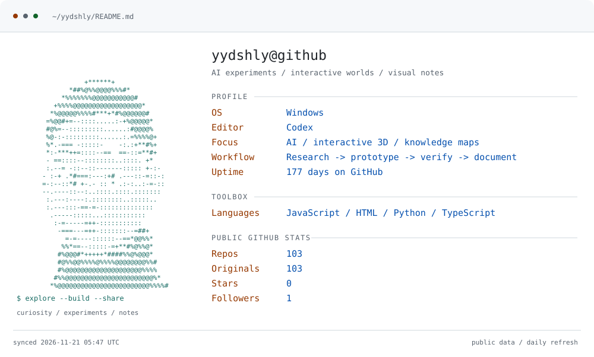

<!-- Generated from profile.json by scripts/update_profile.py. -->
我在探索 AI 怎样帮助一个人把想法做成可运行、可观察的作品。这里记录交互网页、3D 世界、知识可视化与有声讲解的实践，也记录从 GitHub 和 X 上发现的方法。

每个项目尽量保留演示、源码、资料来源和验证记录。你可以先体验效果，再看它怎样实现，以及还有哪些部分需要继续完善。

## 从哪里开始

- **想直接体验交互作品**。[打开演示总览](https://yydshly.github.io/20261104_codex_project/)，按主题选择一个演示，先操作，再回看原理与制作记录。
- **想看一个能游历的 3D 世界**。[试玩镜海](https://yydshly.github.io/mirror-coast-web/)，从旧城出发，步行到海边，或切换载具探索海岸。
- **想看知识怎样被组织和讲解**。[了解植物地球](https://yydshly.github.io/plant-earth/about.html)，先看项目总览和使用路线，再进入地球、植物与地区课堂。

<picture>
  <source media="(max-width: 600px) and (prefers-color-scheme: dark)" srcset="assets/profile-compact-dark.svg">
  <source media="(max-width: 600px)" srcset="assets/profile-compact-light.svg">
  <source media="(prefers-color-scheme: dark)" srcset="assets/profile-dark.svg">
  
</picture>

## 代表作品与研究

### 镜海 · Mirror Coast

一座可以步行、骑行、驾驶、飞行与海上探索的浏览器体素海滨城市。可以从旧城走到海堤，再去码头、南湾或西岬，探索记录和世界变化会保存在当前浏览器。

这个项目把角色与载具控制、场景交互、世界变化和本地存档组合进一个可游历的原型。

[在线试玩](https://yydshly.github.io/mirror-coast-web/) · [源码与说明](https://github.com/yydshly/mirror-coast-web)

持续开发的单机原型，建议使用桌面浏览器、键盘和鼠标。

### 植物地球

面向成年人的植物地理有声图谱。选择一个问题、植物或地区，播放讲解，对照地球、展开地图与环境资料，理解植物为什么分布在不同地方。

这个项目尝试把来源证据、空间展示、语音与字幕放在同一条学习路径里，并保留资料覆盖和缺失说明。

[进入有声图谱](https://yydshly.github.io/plant-earth/) · [源码与说明](https://github.com/yydshly/plant-earth)

已提供在线课程与资料入口，真实使用反馈和学习效果仍在继续验证。

### GitHub 项目研究总库

从 GitHub 与 X 上发现有趣的能力，研究它解决什么问题、怎样实现，以及能用到哪些具体场景。内容涵盖交互效果、3D 创作、视频讲解和知识导航。

每个条目连接原始来源、研究摘要、效果图和可用演示，记录复现中的判断、实测结果与继续扩展的方向。

[浏览研究与演示](https://yydshly.github.io/20261104_codex_project/) · [源码与说明](https://github.com/yydshly/20261104_codex_project)

持续整理的研究档案，各条目的实现范围与验证状态见对应说明。

## 我在探索的方向

- **可操作的 3D 世界与角色**。探索空间生成、动作状态、交互反馈和导览如何组合成可体验的场景。 [云隙行 · 3D 骑行世界](https://yydshly.github.io/20261104_codex_project/011-yunxi-ride/)
- **知识地图与交互讲解**。尝试用地图、图解、来源和使用路线，帮助人进入陌生主题并继续深入。 [见全 · 跨领域认知导航](https://yydshly.github.io/20261104_codex_project/005-jianquan-cognition/)
- **AI 辅助的视觉与视频制作**。研究怎样把素材、场景、动作、时间轴和讲解组织成可修改、可回看的作品。 [Tesseract 的能力与价值](https://yydshly.github.io/20261104_codex_project/004-tesseract-capabilities/)

## 我怎样记录项目

1. 从一个具体问题出发，回到原仓库、官方资料或原始作品核对来源。
2. 做可运行的原型，把视觉、操作和数据放进具体的使用场景。
3. 记录实测结果与失败，说明模拟数据、模型近似和仍待验证的部分。
4. 整理源码、演示、截图或成片，为后续复用和继续修改留下入口。

[查看所有公开仓库](https://github.com/yydshly?tab=repositories) · [回到项目总览](https://yydshly.github.io/20261104_codex_project/)

统计按日更新。Repos 为公开仓库数，Originals 为其中非 fork 仓库数，Stars 为这些非 fork 仓库获得的星标。Languages 按公开非 fork 仓库的主语言出现次数排序。

<!-- Visual concept inspired by https://github.com/Andrew6rant/Andrew6rant. Implementation and artwork generated for this account. -->
